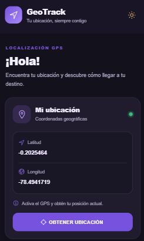
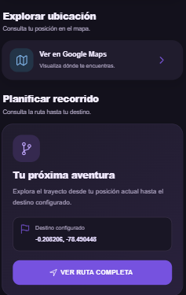
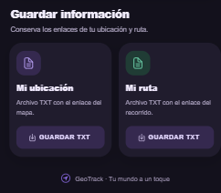

# GeoTrack

Aplicación móvil para consultar la ubicación del dispositivo, abrirla en Google Maps y planificar un recorrido hacia un destino configurado en Quito. Está desarrollada con Ionic y Angular, y utiliza Capacitor para acceder a la geolocalización y al almacenamiento nativo.

## Capturas de pantalla

<table>
  <tr>
    <td align="center" width="50%">
      <strong>Mi ubicación</strong><br /><br />
      
    </td>
    <td align="center" width="50%">
      <strong>Planificación de ruta</strong><br /><br />
      
    </td>
  </tr>
  <tr>
    <td align="center" colspan="2">
      <strong>Guardar información</strong><br /><br />
      
    </td>
  </tr>
</table>

## Funcionalidades

- Obtiene la latitud y longitud actuales mediante el GPS.
- Abre la ubicación actual en Google Maps.
- Traza una ruta desde la ubicación actual hasta el destino configurado (`-0.208206, -78.490448`).
- Guarda los enlaces de ubicación y ruta como archivos TXT.
- Ofrece tema claro y oscuro, y recuerda la preferencia elegida.
- Puede ejecutarse en navegador o como aplicación Android mediante Capacitor.

Si no se puede obtener la ubicación, la aplicación usa como respaldo las coordenadas de Quito (`-0.2025464, -78.4941719`).

## Requisitos

- Node.js y npm.
- Android Studio y Android SDK para compilar o ejecutar la aplicación Android.

## Ejecutar en navegador

```bash
npm install
npm start
```

Abre la dirección local que indique Angular CLI en la terminal (normalmente `http://localhost:4200`). Permite el acceso a la ubicación desde el navegador para obtener las coordenadas del dispositivo.

## Ejecutar en Android

```bash
npm install
npm run build
npx cap sync android
npx cap open android
```

En Android Studio, selecciona un emulador o un dispositivo conectado y ejecuta la aplicación. Concede el permiso de ubicación solicitado por Android. Para probar el GPS en un emulador, configura una ubicación desde sus controles extendidos.

## Comandos disponibles

| Comando | Descripción |
| --- | --- |
| `npm start` | Inicia el servidor de desarrollo de Angular. |
| `npm run build` | Genera la compilación web en `www/`. |
| `npm run watch` | Compila en modo desarrollo y observa cambios. |
| `npm test` | Ejecuta las pruebas configuradas. |
| `npm run lint` | Ejecuta ESLint. |

## Tecnologías

- Angular 22
- Ionic 9
- Capacitor 8
- Capacitor Geolocation y Filesystem
- TypeScript, SCSS e Ionicons

## Estructura del proyecto

```text
src/
├── app/
│   ├── home/           # Pantalla principal y estilos
│   └── services/gps.ts # Geolocalización y guardado de archivos
├── assets/             # Recursos estáticos
└── environments/       # Configuración por entorno
android/                # Proyecto Android de Capacitor
docs/capturas/          # Capturas incluidas en este README
```

## Equipo

**Realizado por Ariel Arias y Emilia Tana**

| Integrante | Rol |
| --- | --- |
| Ariel Arias | Backend |
| Emilia Tana | Frontend |

## Configuración del destino

Las coordenadas del destino se definen en `src/app/home/home.page.ts`, en las propiedades `destinoLat` y `destinoLng`. Actualízalas para cambiar el destino de la ruta.
