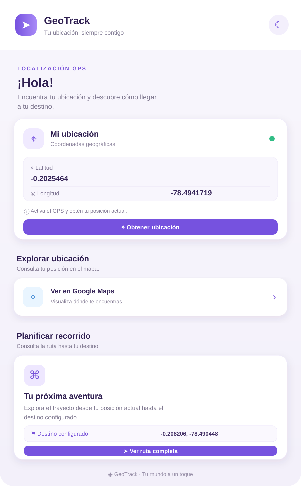

# GeoTrack

Aplicación móvil para consultar la ubicación del dispositivo, abrirla en Google Maps y planificar un recorrido hacia un destino configurado en Quito. GeoTrack está construida con Ionic y Angular, y usa Capacitor para acceder a las funciones nativas de geolocalización y almacenamiento.

## Vista previa



La pantalla principal reúne las coordenadas actuales, accesos a Google Maps y la ruta al destino, y opciones para guardar los enlaces como archivos de texto. El botón de la esquina superior permite alternar entre tema claro y oscuro.

## Funciones

- Obtención de latitud y longitud con el GPS del dispositivo.
- Apertura de la ubicación actual en Google Maps.
- Consulta de una ruta desde la ubicación actual hasta el destino configurado (`-0.208206, -78.490448`).
- Descarga de enlaces de ubicación y recorrido como archivos TXT.
- Tema claro y oscuro, con preferencia guardada localmente.
- Compatibilidad con navegador y compilación Android mediante Capacitor.

Si no se puede obtener la ubicación, el servicio devuelve coordenadas de respaldo de Quito (`-0.2025464, -78.4941719`).

## Requisitos

- Node.js y npm.
- Android Studio y el SDK de Android si se desea ejecutar la aplicación como app Android.

## Puesta en marcha web

```bash
npm install
npm start
```

Abre la dirección local que indique Angular CLI en la terminal (normalmente `http://localhost:4200`). El navegador debe permitir el acceso a la ubicación para usar el GPS real; si no se concede, se mostrarán las coordenadas de respaldo de Quito.

## Android

Después de instalar las dependencias, compila la aplicación web y sincronízala con el proyecto Android:

```bash
npm install
npm run build
npx cap sync android
npx cap open android
```

En Android Studio, selecciona un emulador o dispositivo conectado y ejecuta la app. Al usar la ubicación, concede el permiso solicitado por el sistema. Para probar el GPS en un emulador, configura una ubicación desde los controles extendidos del emulador.

## Comandos disponibles

| Comando | Descripción |
| --- | --- |
| `npm start` | Inicia el servidor de desarrollo de Angular. |
| `npm run build` | Genera la compilación web en `www/`. |
| `npm run watch` | Compila en modo desarrollo y observa cambios. |
| `npm test` | Ejecuta las pruebas configuradas. |
| `npm run lint` | Ejecuta ESLint. |

## Tecnologías

- Angular 22
- Ionic 9
- Capacitor 8
- Capacitor Geolocation y Filesystem
- TypeScript, SCSS e Ionicons

## Estructura del proyecto

```text
src/
├── app/
│   ├── home/           # Pantalla principal y estilos
│   └── services/gps.ts # Geolocalización y guardado de archivos
├── assets/             # Recursos estáticos
└── environments/       # Configuración por entorno
android/                # Proyecto nativo Android de Capacitor
docs/capturas/          # Imágenes de vista previa para este README
```

## Configuración del destino

Las coordenadas del destino se definen en `src/app/home/home.page.ts`, en las propiedades `destinoLat` y `destinoLng`. Actualízalas para cambiar el lugar al que apunta la planificación de ruta.

